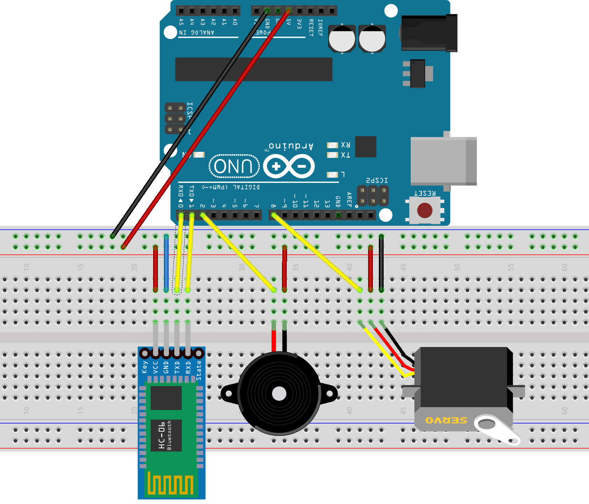
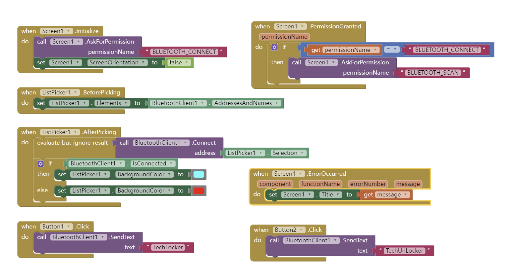

# TechLocker

스마트폰으로 원격 잠금/해제하는 자물쇠입니다. 열쇠를 잃어버리거나 비밀번호가 노출되는 문제를 줄이려고, 앱이 설치된 본인 스마트폰으로만 열 수 있게 만들었습니다.

23-2, 팀 프로젝트 (4인, 팀장)

[시연 영상 (YouTube)](https://www.youtube.com/watch?v=OBdjbJFhI0M)

<p>
  
  
</p>

## 동작

1. 앱(App Inventor)에서 블루투스로 아두이노에 연결합니다.
2. LOCK을 누르면 잠금 문자열을 보내고, 서보모터가 회전식 자물쇠를 잠근 뒤 알림음이 나고 LED가 켜집니다.
3. UNLOCK을 누르면 반대 방향으로 돌아 잠금이 풀리고, 알림음이 나고 LED가 꺼집니다.
4. 이미 잠긴 상태에서 LOCK을 다시 누르면(열린 상태에서 UNLOCK도 마찬가지) 무시해서, 서보가 같은 방향으로 계속 도는 것을 막았습니다.

## 문제 해결

- 블루투스, 서보, 스피커, LED를 동시에 동작시키자 일부 부품이 출력 부족으로 동작하지 않아, 순서대로 동작하도록 바꿨습니다.
- 버튼을 연달아 누르면 서보가 계속 돌아서, LED 상태로 잠금 여부를 판단해 같은 명령을 막았습니다.
- 아두이노, 배터리, 브레드보드를 겹쳐 상자 하나에 넣어 부피를 줄였습니다.

## 구성

```text
.
├── arduino/TechLocker/TechLocker.ino
├── app/TechLocker.aab        # App Inventor 앱
└── docs/
    ├── breadboard.png        # 회로도 (Fritzing)
    ├── circuit.fzz           # Fritzing 원본
    ├── app_inventor_blocks.png
    └── leaflet.jpg           # 리플릿
```

하드웨어: 아두이노, 블루투스 모듈, 서보모터, 피에조 스피커, LED, 배터리

## 회고

목표 기능은 모두 만들었지만, 일반 자물쇠보다 전력 소모가 많고 부피가 크다는 점이 아쉬웠습니다. 전력 사용량을 줄이고 크기를 더 줄여 휴대할 수 있게 만드는 것이 다음 목표입니다.

## 정리 내역

포트폴리오로 올리면서 아두이노 코드의 핀 번호와 서보 값을 상수로 빼고 함수로 나눴고, 받은 명령 문자열의 앞뒤 공백을 지우는 처리를 추가했습니다.

## 기술 스택

Arduino, MIT App Inventor, Bluetooth, Fritzing

## 라이선스

[MIT](LICENSE)
